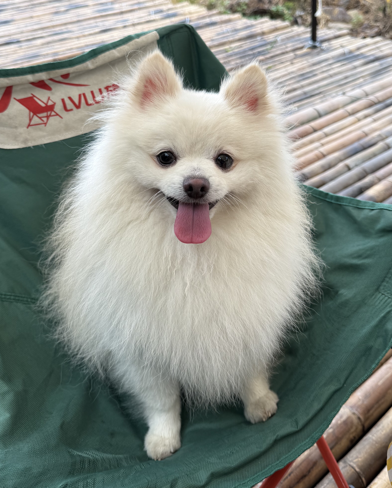

## Education

- MSc Computer Science (Artificial Intelligence) - Leiden University, The Netherlands (2025–2027)
- BSc Physics - Shanghai Normal University, China (2016–2020)
- Post-University Education - University of Helsinki, Finland (2024–2025)

## Experience

I previously worked as a Data Scientist and AI Specialist before, gaining professional experience in machine learning, predictive modeling, and data analytics. I have worked on recommendation systems, personalized advertising, and deep learning applications, using data-driven approaches to solve real-world business problems.

## My Dog (Caesar)
{width=350px}