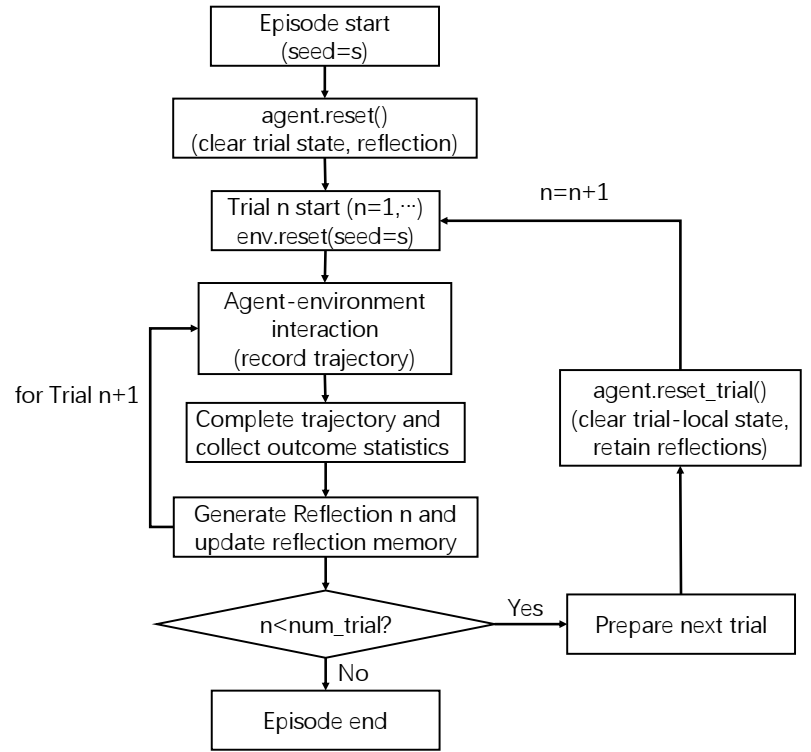
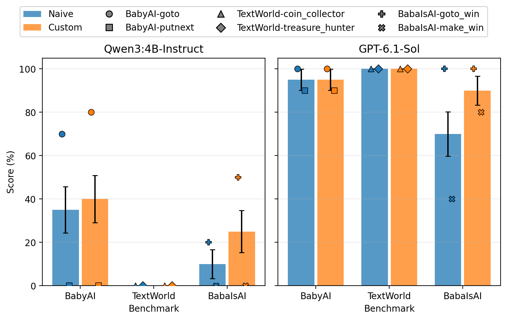
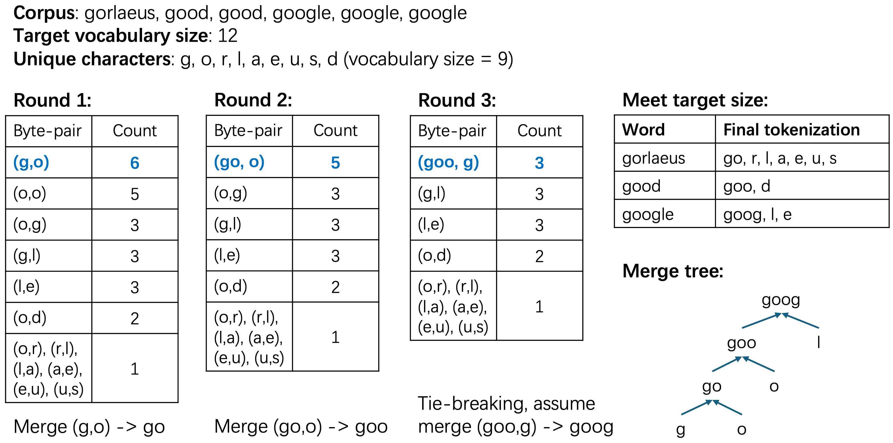
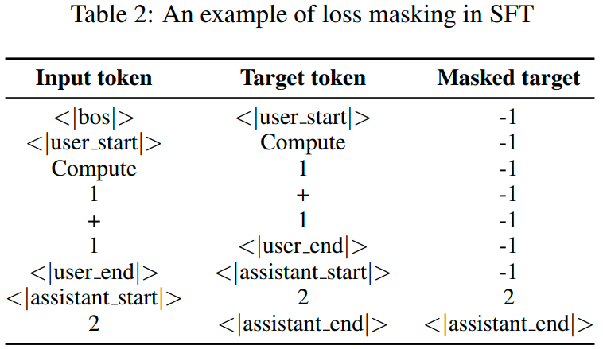
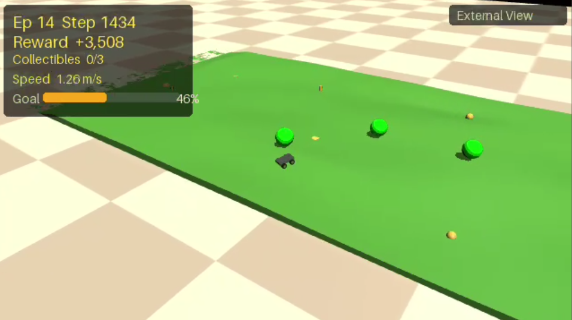
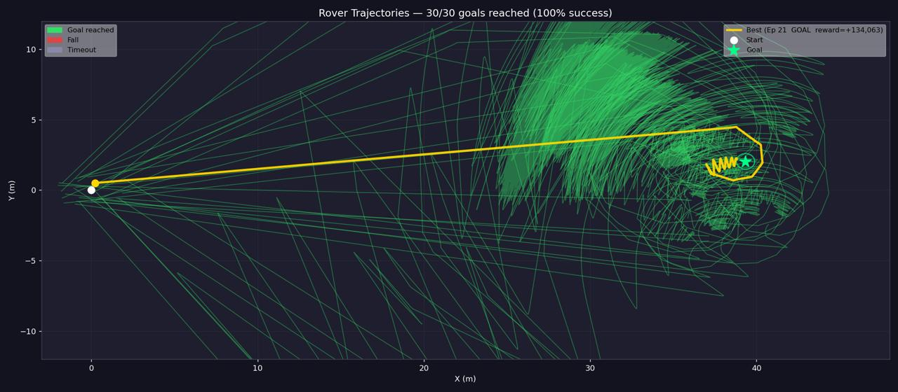
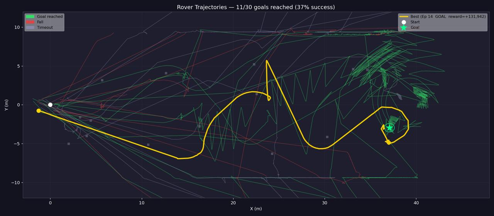
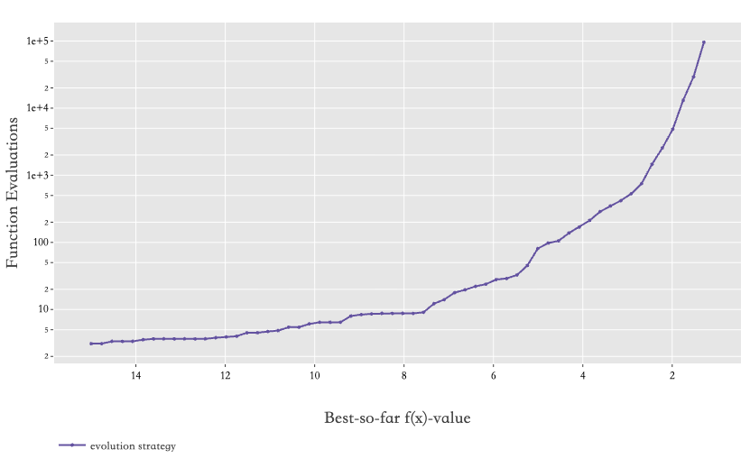
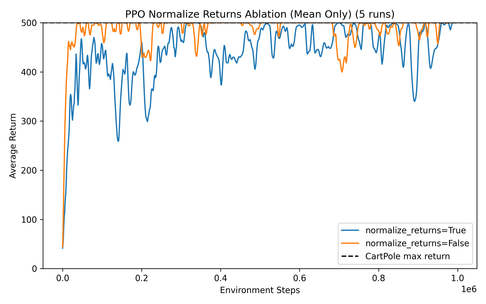
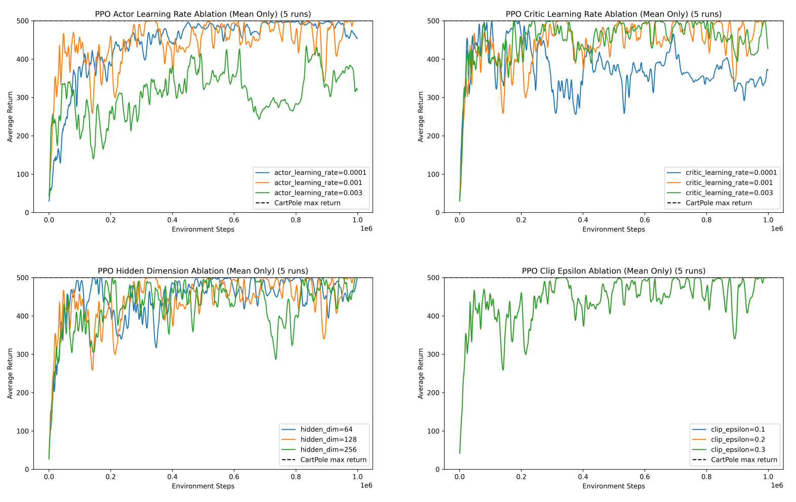

## Planning and Reflection for Agentic LLMs
`Agent Evaluation` | `Brittleness` | `Harnessing` | `BALROG` | `ReAct` | `Reflection`

- Built a reproducible BALROG evaluation pipeline for GPT-6.1-sol and Qwen3-4B-Instruct across BabyAI, TextWorld, and BabaIsAI, using seeded multi-episode experiments and automated performance reporting.
- Designed a ReAct-inspired language agent with dynamic planning, structured action generation, short-term memory, and explicit detection of repeated actions and state loops.
- Implemented and evaluated a Reflexion-style agent that converts trial outcomes into verbal memory, comparing matched with/without-reflection conditions using trial-level progression.

```{=html}
<div class="img-container" style="display: flex; gap: 2px; align-items: flex-start;">
  
  
</div>
```


## End-to-End Small LLM Development with Nanochat
`LLM Training Pipeline` | `Instruction Fine-tuning` | `Model Evaluation` | `Nanochat` | `Tokenization`

- Trained and compared 8K and 32K BPE tokenizers on 500MB of CLIMBMix data, then pre-trained a 13M-parameter Transformer while monitoring convergence through training and validation BPB.
- Designed a two-stage post-training pipeline using MMLU and GSM8K for capability-focused mid-training, followed by supervised fine-tuning on SmolTalk with assistant-only loss masking.
- Evaluated model checkpoints on ARC-Easy, ARC-Challenge, and GSM8K, analyzed domain shift and catastrophic forgetting, and tested temperature sampling and KV caching through a web inference interface.

```{=html}
<div class="img-container" style="display: flex; gap: 2px; align-items: flex-start;">
  
  
</div>
```


## ### Adversarial Curriculum Learning for Autonomous Rover Navigation

`Reinforcement Learning` | `Proximal Policy Optimization` | `MuJoCo` | `Robotics`

- Developed an autonomous rover navigation system using Proximal Policy Optimization (PPO) in MuJoCo, training a four-wheeled robot to navigate procedurally generated terrains with varying obstacles and difficulty levels.
- Designed an adversarial curriculum learning mechanism that dynamically adjusts terrain difficulty based on the agent's success rate and failure patterns, enabling adaptive reinforcement learning.
- Evaluated the trained policy across different terrain difficulties, achieving a 100% success rate on flat terrain and 36.7% on moderately challenging terrain over 30 evaluation episodes per setting.

<p> <a href="https://github.com/Rahulrayy/Robotics_Project">Code</a> </p>

```{=html}
<div class="img-container" style="display: flex; gap: 2px; align-items: flex-start;">
  
</div>

<div style="margin: 20px 0; max-width: 700px;">
  <iframe
    width="100%"
    style="aspect-ratio: 16 / 9; border: 0; border-radius: 8px;"
    src="https://www.youtube.com/embed/WeDk9vNZHuE"
    title="Autonomous Rover Navigation Demo"
    allow="accelerometer; autoplay; clipboard-write; encrypted-media; gyroscope; picture-in-picture; web-share"
    allowfullscreen>
  </iframe>
</div>

<div class="img-container" style="display: flex; gap: 2px; align-items: flex-start;">
  
</div>

<div class="img-container" style="display: flex; justify-content: flex-start; gap: 10px; align-items: flex-start;">
  
</div>


```


## Evolutionary Algorithm on Black-box Problems
`Genetic Algorithm` | `Evolutionary Strategy` | `Optimization` | `Black-box Problems`

- Implemented Genetic Algorithm (GA) and self-adaptive $(\mu,\lambda)$ Evolution Strategy (ES) from scratch for discrete and continuous optimization.
- Applied GA to [LABS and N-Queens](https://iohprofiler.github.io/IOHexp/) [@IOHprofiler;@IOHanalyzer;@IOHexperimenter], and ES with log-normal step-size adaptation to the Katsuura problem.
- Designed a budget-aware, step-wise hyperparameter tuning strategy to efficiently identify promising configurations.
- Evaluated convergence and robustness using EAF, ECDF, and Expected Runtime (ERT) across multiple runs.

```{=html}
<div class="img-container" style="display: flex; justify-content: flex-start; gap: 10px; align-items: flex-start;">
  
</div>
```

### Implementation and Evaluation of Proximal Policy Optimization (PPO)

`Reinforcement Learning` | `PPO` | `Actor-Critic` | `CartPole-v1` | `Hyperparameter Optimization`

- Implemented Proximal Policy Optimization (PPO) based on the Actor-Critic framework, incorporating a clipped surrogate objective to stabilize policy updates in the CartPole-v1 environment.
- Conducted hyperparameter tuning and ablation studies on learning rates, network architectures, clipping thresholds, and training techniques to investigate their effects on convergence and training stability.
- Compared PPO against REINFORCE, Actor-Critic (AC), A2C, and DQN-based methods.

```{=html}
<div class="img-container" style="display: flex; gap: 2px; align-items: flex-start;">
  
  
</div>
```